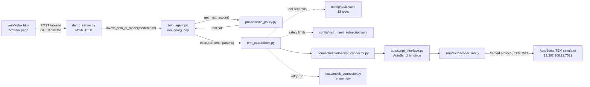
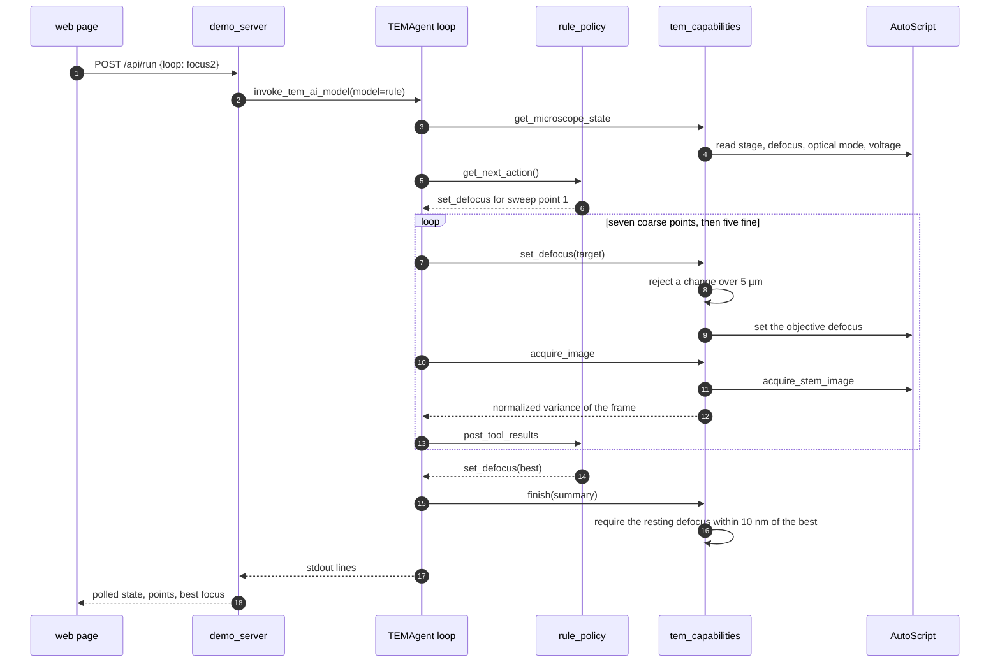
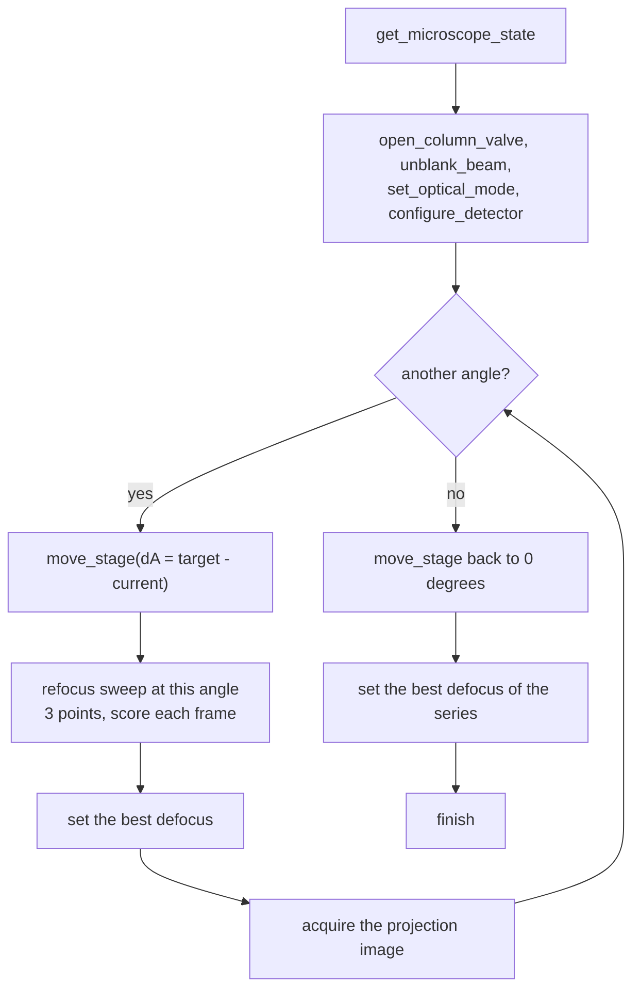
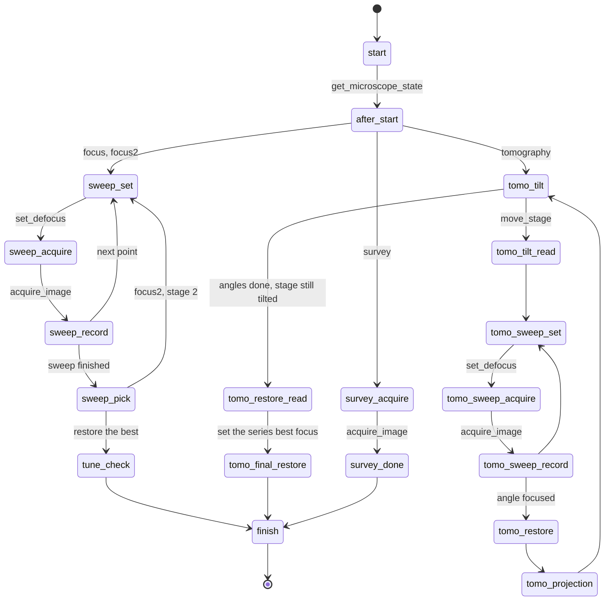

# How the demo is wired

The TEM Agent runs its optimisation loops with a deterministic policy, so a demo
needs no LLM, no API key and no network call to a model provider. These diagrams
are the wiring and the two workflows the demo offers.

The same Mermaid source sits in `web/index.html` behind a fold, so the page can
be re-rendered wherever Mermaid is available.

## Components



Node colour is the same link at two levels of detail:

| Hop | What crosses it |
| --- | --- |
| page to `demo_server.py` | `POST /api/run` with the loop, the dry-run flag and the host, then `GET /api/state` polling while the agent prints |
| `demo_server.py` to `tem_agent.py` | `invoke_tem_ai_model(model_name="rule")` on a background thread, with the agent's stdout captured line by line |
| loop to `rule_policy.py` | `get_next_action()` returns the next tool call; each result returns through `post_tool_results()` |
| loop to `tem_capabilities.py` | the tool call itself, with every argument checked against the instrument YAML before anything reaches the instrument |
| capabilities to connector | one of two connectors: the AutoScript one for hardware, the mock one under `--dry-run` |
| connector to simulator | `autoscript_interface.py` calls `TemMicroscopeClient`, which speaks the AutoScript framed protocol to port 7521. No HTTP anywhere in this hop |

## The focus loop, step by step



## The tomography loop



## The policy's own state machine

Each loop is a small state machine. Every `get_next_action()` call returns one
tool call, and the result it gets back decides the next state.



## What the state read returns

`autoscript_interface.get_microscope_state()` is the only place the agent learns
anything about the instrument. One reading carries:

| Key | Meaning |
| --- | --- |
| `voltage_kv` | acceleration voltage in kilovolts |
| `magnification` | nominal value of the current magnification step |
| `defocus_m` | objective defocus in metres, read from the STEM or TEM focusing branch according to the optical mode |
| `stage_position` | X, Y, Z in metres; A and B in degrees |
| `beam_blanked` | whether the beam blanker is engaged |
| `column_valve_open` | whether the column valve is open |
| `optical_mode` | `Stem` or `Tem`, which decides whether an acquisition is a scan or a camera frame |
| `detector` | the configured detector name, dwell time and image shape |

## Current state of the simulator

The demo drives either connector. Against `13.202.106.11:7521` the TCP connection
and the AutoScript handshake both succeed, and then every call is refused:

```
ApplicationServerException: AutoScript TEM product is not activated properly.
```

That is a server-side licence state on the simulator host, not something a client
can work around: the vendor reference manual states an offline licence is required
to use AutoScript in offline mode, and the client library exposes no licence API.
`POST /api/simcheck` reports the same three facts the page shows — reachable,
refused, and why. `--dry-run` needs none of it.
