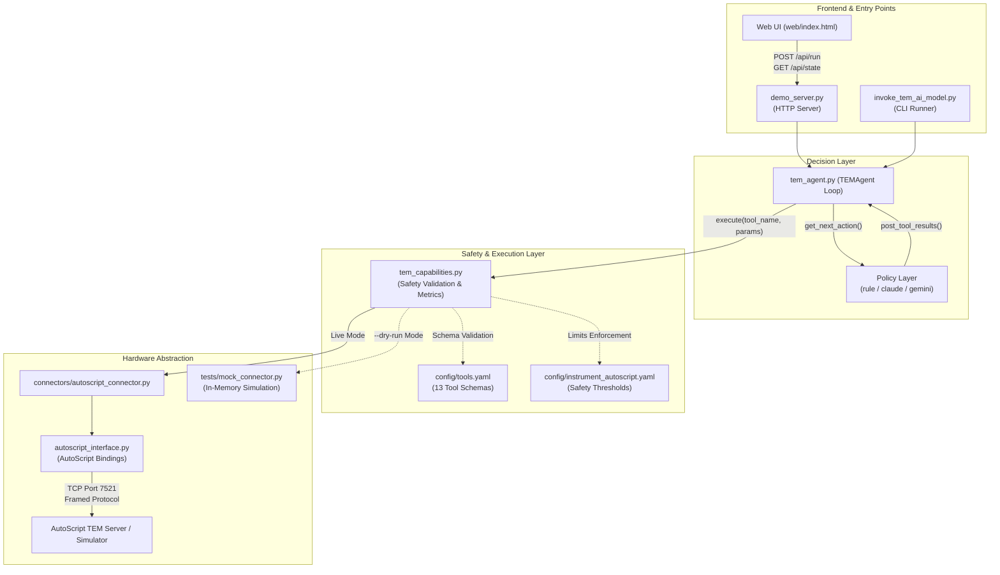

# TEM AI Agent

An autonomous, model-agnostic AI agent for Transmission Electron Microscopes (TEM). It automates complex microscopy workflows—such as autofocusing, fine sweeps, tomography tilt series, and specimen surveys—using either deterministic state-machine rules or large language models (**Claude** and **Gemini**).

The system includes both an interactive **Web Dashboard** (`demo_server.py`) and a scriptable **CLI** (`invoke_tem_ai_model.py`), backed by strict specimen safety controls and an interchangeable instrument abstraction layer.

---

## Table of Contents

- [Key Capabilities](#key-capabilities)
- [How It Works](#how-it-works)
  - [System Architecture](#system-architecture)
  - [Supported Workflows](#supported-workflows)
  - [Execution Modes: Dry-Run vs. Live](#execution-modes-dry-run-vs-live)
- [Repository Structure](#repository-structure)
- [Prerequisites](#prerequisites)
- [Getting Started](#getting-started)
  - [1. Clone and Create Virtual Environment](#1-clone-and-create-virtual-environment)
  - [2. Install Dependencies](#2-install-dependencies)
  - [3. Configure Environment Variables](#3-configure-environment-variables)
- [Starting the Application](#starting-the-application)
  - [Option A: Web Dashboard (Interactive UI)](#option-a-web-dashboard-interactive-ui)
  - [Option B: Command-Line Interface (CLI)](#option-b-command-line-interface-cli)
- [API Documentation](#api-documentation)
  - [REST API Reference (`demo_server.py`)](#rest-api-reference-demo_serverpy)
    - [GET `/api/loops`](#1-get-apiloops)
    - [POST `/api/run`](#2-post-apirun)
    - [GET `/api/state`](#3-get-apistate)
    - [POST `/api/simcheck`](#4-post-apisimcheck)
  - [Programmatic Python API](#programmatic-python-api)
    - [High-Level Runner: `invoke_tem_ai_model()`](#high-level-runner-invoke_tem_ai_model)
    - [Component Architecture (`TEMAgent` & Capabilities)](#component-architecture-temagent--capabilities)
- [Connecting to the AutoScript Simulator](#connecting-to-the-autoscript-simulator)
  - [Network & Firewall Requirements](#network--firewall-requirements)
  - [Simulator Licensing](#simulator-licensing)
- [Safety Controls & Guardrails](#safety-controls--guardrails)
- [Extensibility](#extensibility)
  - [Adding a New Tool](#adding-a-new-tool)
  - [Connecting to a Physical Microscope](#connecting-to-a-physical-microscope)

---

## Key Capabilities

* **Autonomous Microscopy Loops**: Out-of-the-box routines for single-stage focus sweeps, two-stage coarse/fine sweeps, tomography series, and column surveys.
* **Deterministic or LLM-Driven Policies**:
  * `rule` (Default): Fast, deterministic state-machine policy. Requires **no LLM, no API keys, and zero cloud billing**.
  * `claude`: Anthropic Messages API backend for goal-driven autonomous reasoning.
  * `gemini`: Google Generative AI backend for tool-calling loops.
* **Live Web Dashboard**: Browser-based interface at `http://127.0.0.1:8765` featuring one-click simulator health checks, real-time stdout streaming, execution status, and interactive focus/variance charts.
* **Specimen Protection**: Software-enforced limits on stage travel, tilt angles, and lens defocus delta per action. Automatically blanks the electron beam and closes the column valve on completion or unhandled exceptions.
* **Hardware Abstraction**: Seamlessly switch between the Thermo Fisher AutoScript client, an in-memory mock simulator, or a custom physical instrument connector.

---

## How It Works

### System Architecture

The application cleanly decouples the decision engine (Policy), execution safeguards (Capabilities), and hardware communication (Connectors):



### Supported Workflows

1. **Focus Sweep (`focus`)**:
   Sweeps objective lens defocus across 7 points around the starting position, computes normalized image variance for each acquisition to assess sharpness, and restores the microscope to the peak focus defocus.
2. **Two-Stage Focus Sweep (`focus2`)**:
   Executes a coarse 7-point sweep to locate the focal zone, followed by a refined 5-point pass around the coarse peak before restoring the best focus.
3. **Tomography Tilt Series (`tomography`)**:
   Tilts the specimen stage through targeted angles (e.g. -20°, 0°, +20°), performs autofocus sweeps at each angle, captures projection images, and resets the stage to 0° resting state.
4. **Survey (`survey`)**:
   Reads microscope telemetry, verifies/opens the column valve, unblanks the beam, ensures STEM mode, configures the detector, and captures a reference image.

### Execution Modes: Dry-Run vs. Live

* **Dry-Run Mode (`--dry-run` or UI checkbox)**:
  Uses `MockTEMConnector` entirely in-memory. Does not require microscope hardware, AutoScript software, or network connectivity. Ideal for validating prompt policies, testing UI interactions, and CI/CD pipelines.
* **Live Mode**:
  Connects to a running Thermo Fisher AutoScript TEM server or simulator instance via TCP port `7521`. Requires the proprietary `autoscript_tem_microscope_client` Python package.

---

## Repository Structure

```
tem-agent/
├── demo_server.py             # HTTP server providing Web UI and REST API
├── invoke_tem_ai_model.py     # Canonical CLI entry point
├── tem_agent.py               # Core orchestrator loop (Action -> Execution -> Feedback)
├── tem_capabilities.py        # Tool execution engine with safety boundary enforcement
├── tool_registry.py           # Loads and validates tools from config/tools.yaml
├── instrument_registry.py     # Loads hardware safety constraints from config/
├── autoscript_interface.py    # Low-level bindings to Thermo Fisher AutoScript SDK
├── tem_context.txt            # System prompt and operational constraints for LLM backends
├── requirements.txt           # Python package dependencies
├── .env.example               # Template for environment configuration
│
├── web/
│   └── index.html             # Single-page web dashboard (UI, charts, Mermaid diagrams)
│
├── config/
│   ├── tools.yaml                 # Definitions and JSON schemas for all 13 tools
│   └── instrument_autoscript.yaml # Instrument safety limits (defocus, stage, voltage)
│
├── policies/
│   ├── base_policy.py         # Abstract base class for all policy implementations
│   ├── rule_policy.py         # Deterministic state-machine policy (model-free)
│   ├── claude_policy.py       # Anthropic Claude tool-calling policy
│   └── gemini_policy.py       # Google Gemini tool-calling policy
│
├── connectors/
│   └── autoscript_connector.py # Live microscope connector wrapping autoscript_interface
│
└── tests/
    └── mock_connector.py      # In-memory mock connector used in dry-run mode
```

---

## Prerequisites

* **Python 3.10+** (Python 3.10 to 3.12 recommended)
* **AutoScript Client SDK** (Required only for live connections to the microscope/simulator):
  Installed via Thermo Fisher wheel `autoscript_tem_microscope_client-*.whl`
* *(Optional)* **API Keys**:
  * `ANTHROPIC_API_KEY` for Claude (`claude-sonnet-4-6` or custom)
  * `GEMINI_API_KEY` for Gemini (`gemini-2.0-flash` or custom)

---

## Getting Started

### 1. Clone and Create Virtual Environment

Always run the agent inside a dedicated virtual environment so all AutoScript SDK packages and dependencies resolve correctly:

**On Windows (PowerShell):**
```powershell
cd d:\OSS\oss-devsetup\tem-agent
python -m venv .venv
.\.venv\Scripts\Activate.ps1
```

**On Linux / macOS (Bash):**
```bash
cd tem-agent
python3 -m venv .venv
source .venv/bin/activate
```

### 2. Install Dependencies

```bash
pip install --upgrade pip
pip install -r requirements.txt
```

> [!NOTE]
> If connecting to a live simulator or real TEM instrument, ensure `autoscript_tem_microscope_client` is installed in this virtual environment. Verify with:
> ```bash
> python -c "import autoscript_tem_microscope_client; print('AutoScript SDK OK')"
> ```

### 3. Configure Environment Variables

Create your local `.env` file from the provided template:

```bash
cp .env.example .env
```

Open `.env` and set your configuration:

```env
# AutoScript TEM server (simulator or physical instrument)
AUTOSCRIPT_HOST=65.1.231.167
AUTOSCRIPT_PORT=7521

# Only needed if running --model claude
ANTHROPIC_API_KEY=your_anthropic_api_key_here
CLAUDE_MODEL=claude-sonnet-4-6

# Only needed if running --model gemini
GEMINI_API_KEY=your_gemini_api_key_here
GEMINI_MODEL=gemini-2.0-flash
```

---

## Starting the Application

You can operate the TEM Agent either through the **interactive Web Dashboard** or the **scriptable CLI**.

### Option A: Web Dashboard (Interactive UI)

The Web Dashboard allows you to test network connectivity, verify simulator licensing, select workflows, trigger runs, and inspect live feedback charts without memorizing CLI arguments.

1. **Start the demo server** using the virtual environment Python:

   **Windows:**
   ```powershell
   .\.venv\Scripts\python.exe demo_server.py
   ```

   **Linux / macOS:**
   ```bash
   python demo_server.py
   ```

   By default, the server listens on `http://127.0.0.1:8765`. To bind to a custom port or host:
   ```bash
   python demo_server.py --port 9000 --host 0.0.0.0
   ```

2. **Open the Dashboard**:
   Navigate to [http://127.0.0.1:8765](http://127.0.0.1:8765) in your web browser.

3. **Using the Dashboard**:
   * **Check Simulator**: Click the **Check simulator** button. It connects to the configured `host:port` and reports whether the server is reachable and properly licensed (`answered, optical mode 'Tem'`).
   * **Choose Policy**: Select `rule` (no API key required), `claude`, or `gemini`.
   * **Toggle Dry-Run**: Keep **Dry-run (mock)** checked to simulate locally without hardware, or uncheck it to execute commands against the live simulator.
   * **Run Loop**: Choose between *Focus sweep*, *Focus sweep (two-stage)*, *Tomography*, or *Survey*, and click **Run loop**.
   * **Monitor Progress**: Watch stdout stream line-by-line, inspect real-time focus variance graphs, and review the best observed defocus upon completion.

---

### Option B: Command-Line Interface (CLI)

`invoke_tem_ai_model.py` is the canonical entry point for automated or scriptable runs.

#### 1. Dry-Run Mode (No hardware or API keys required with rule policy)

```bash
# Deterministic rule policy in dry-run mode
python invoke_tem_ai_model.py --model rule --dry-run

# Run a two-stage focus sweep in dry-run
python invoke_tem_ai_model.py --model rule --goal focus2 --dry-run

# Run dry-run with an LLM backend (requires API key)
python invoke_tem_ai_model.py --model claude --dry-run
python invoke_tem_ai_model.py --model gemini --dry-run
```

#### 2. Live Simulator Mode (Connected to AutoScript)

Ensure `AUTOSCRIPT_HOST` and `AUTOSCRIPT_PORT` are configured in `.env`.

```bash
# Run standard focus sweep against the simulator using rule policy
python invoke_tem_ai_model.py --model rule

# Run tomography tilt series against the simulator
python invoke_tem_ai_model.py --model rule --goal tomography

# Run with Claude on custom natural-language instructions
python invoke_tem_ai_model.py --model claude \
  --goal "Perform a focus sweep at 4300x magnification and restore the peak focus."

# Cap the maximum iterations for safety
python invoke_tem_ai_model.py --model rule --max-iterations 30
```

---

## API Documentation

The TEM Agent provides two programmatic integration surfaces: an **HTTP REST API** served by `demo_server.py` and a **Python Programmatic API** for embedding the agent loop directly into scientific scripts and automation pipelines.

### REST API Reference (`demo_server.py`)

The local HTTP server (`demo_server.py`) exposes JSON endpoints used by the Web Dashboard and external orchestrators.

* **Base URL**: `http://127.0.0.1:8765` (configurable via `--host` and `--port`)
* **Headers**: All JSON responses include `Content-Type: application/json` and `Cache-Control: no-store`.

#### 1. GET `/api/loops`

Returns the supported workflow routines, default microscope host/port, supported policy backends, and execution limits.

* **Method**: `GET`
* **Query Parameters**: None
* **Success Response (200 OK)**:
  ```json
  {
    "loops": [
      {
        "id": "focus",
        "title": "Focus sweep",
        "blurb": "One defocus sweep across seven points around the current focus, each frame scored by normalized variance, then the peak restored."
      },
      {
        "id": "focus2",
        "title": "Focus sweep, two-stage",
        "blurb": "A coarse seven-point sweep, then a finer five-point pass around the coarse peak."
      },
      {
        "id": "tomography",
        "title": "Tomography tilt series",
        "blurb": "Tilt to each angle in turn, refocus at every angle, acquire a projection, then restore the stage to zero."
      },
      {
        "id": "survey",
        "title": "Survey",
        "blurb": "Read the microscope state, open the column valve, unblank, select STEM, configure the detector, take one image."
      }
    ],
    "default_host": "13.202.106.11",
    "default_port": 7521,
    "models": ["rule", "claude", "gemini"],
    "default_model": "rule",
    "max_iterations": 60
  }
  ```
* **Example**:
  ```bash
  curl -s http://127.0.0.1:8765/api/loops
  ```

---

#### 2. POST `/api/run`

Triggers an asynchronous agent execution loop on a dedicated background thread.

* **Method**: `POST`
* **Headers**: `Content-Type: application/json`
* **Request Body**:
  | Field | Type | Default | Description |
  |---|---|---|---|
  | `loop` | `string` | `"focus"` | Workflow ID: `"focus"`, `"focus2"`, `"tomography"`, or `"survey"`. |
  | `model` | `string` | `"rule"` | Policy engine: `"rule"`, `"claude"`, or `"gemini"`. |
  | `dry_run` | `boolean` | `true` | If `true`, runs against `MockTEMConnector`. If `false`, connects to live AutoScript server. |
  | `host` | `string` | `AUTOSCRIPT_HOST` | Target AutoScript server hostname or IP address. |
  | `port` | `integer` | `AUTOSCRIPT_PORT` | Target AutoScript server TCP port (default `7521`). |

* **Request Example**:
  ```json
  {
    "loop": "focus2",
    "model": "rule",
    "dry_run": true
  }
  ```
* **Success Response (200 OK)**:
  ```json
  {
    "id": "b3e9a71f02c4"
  }
  ```
* **Error Response (400 Bad Request)**:
  ```json
  {
    "error": "unknown loop 'custom_sweep'"
  }
  ```
* **Example**:
  ```bash
  curl -X POST http://127.0.0.1:8765/api/run \
    -H "Content-Type: application/json" \
    -d '{"loop": "focus", "model": "rule", "dry_run": true}'
  ```

---

#### 3. GET `/api/state`

Polls the real-time execution state, newly emitted log lines, parsed focus/variance points, and termination status for a given run ID.

* **Method**: `GET`
* **Query Parameters**:
  | Parameter | Type | Required | Description |
  |---|---|---|---|
  | `id` | `string` | **Yes** | Run identifier returned by `POST /api/run`. |
  | `since` | `integer` | No | Line offset for delta streaming. Omit or set to `0` for all lines. |

* **Success Response (200 OK)**:
  ```json
  {
    "id": "b3e9a71f02c4",
    "loop": "focus",
    "dry_run": true,
    "host": "13.202.106.11",
    "port": 7521,
    "model": "rule",
    "status": "done",
    "lines": [
      "[RulePolicy] Step 1: get_microscope_state",
      "[Capabilities] Current defocus: 0.000 nm",
      "[RulePolicy] -150.0 nm -> normalized variance 0.08412",
      "TASK COMPLETE: Peak focus located and restored."
    ],
    "next": 18,
    "points": [
      { "tilt": null, "df_nm": -150.0, "score": 0.08412 },
      { "tilt": null, "df_nm": -100.0, "score": 0.12540 }
    ],
    "best": {
      "df_nm": 0.0,
      "score": 0.28451
    },
    "iterations": 8,
    "error": null,
    "notice": null
  }
  ```
  * `status`: `"running"`, `"done"`, `"stopped"`, or `"failed"`.
  * `lines`: Array of stdout lines emitted since `since`.
  * `next`: Total lines emitted so far; pass this as `since` on the next poll.
  * `points`: Parsed data points extracted from policy logs (used to draw the live sharpness curve).
  * `best`: Best observed defocus (`df_nm`) and sharpness metric (`score`).
  * `notice`: Plain-language explanation if the AutoScript license is inactive.
* **Error Response (404 Not Found)**:
  ```json
  {
    "error": "unknown run"
  }
  ```
* **Example**:
  ```bash
  curl -s "http://127.0.0.1:8765/api/state?id=b3e9a71f02c4&since=0"
  ```

---

#### 4. POST `/api/simcheck`

Health check probe that tests TCP reachability on port 7521 and verifies Thermo Fisher AutoScript license activation status by querying optical mode telemetry.

* **Method**: `POST`
* **Headers**: `Content-Type: application/json`
* **Request Body**:
  | Field | Type | Default | Description |
  |---|---|---|---|
  | `host` | `string` | `AUTOSCRIPT_HOST` | Microscope server IP or hostname. |
  | `port` | `integer` | `AUTOSCRIPT_PORT` | AutoScript TCP port (typically `7521`). |

* **Request Example**:
  ```json
  {
    "host": "13.202.106.11",
    "port": 7521
  }
  ```
* **Success Response (200 OK)**:
  ```json
  {
    "host": "13.202.106.11",
    "port": 7521,
    "tcp": true,
    "activation": "ok",
    "detail": "answered, optical mode 'Tem'"
  }
  ```
  * `tcp`: `true` if TCP socket connection succeeded.
  * `activation`: `"ok"` (licensed), `"refused"` (unlicensed server), or `null` (TCP unreachable).
  * `detail`: Description or raw server exception.
* **Example**:
  ```bash
  curl -X POST http://127.0.0.1:8765/api/simcheck \
    -H "Content-Type: application/json" \
    -d '{"host": "13.202.106.11", "port": 7521}'
  ```

---

### Programmatic Python API

For embedding TEM AI workflows directly into Python scripts, Jupyter notebooks, or scientific pipelines.

#### High-Level Runner: `invoke_tem_ai_model()`

Located in [`invoke_tem_ai_model.py`](file:///d:/OSS/oss-devsetup/tem-agent/invoke_tem_ai_model.py):

```python
from invoke_tem_ai_model import invoke_tem_ai_model

# Run an autonomous autofocus sweep with the deterministic rule engine (no LLM, no API keys)
invoke_tem_ai_model(
    model_name="rule",
    goal_text="focus",            # or "focus2", "tomography", "survey"
    max_iterations=40,
    dry_run=True                  # set False to execute against live hardware
)

# Run an LLM-driven reasoning loop with Claude or Gemini
invoke_tem_ai_model(
    model_name="claude",
    goal_text="Inspect current defocus, take an image, and optimize focus to peak normalized variance.",
    max_iterations=30,
    dry_run=False
)
```

**Parameters**:
* `model_name` (*str*): Policy selector — `"rule"`, `"claude"`, or `"gemini"`.
* `goal_text` (*str*): Workflow identifier (`"focus"`, `"focus2"`, `"tomography"`, `"survey"`) or custom natural language instructions for LLM policies.
* `max_iterations` (*int*, default `40`): Safety iteration cap.
* `dry_run` (*bool*, default `False`): Run with mock connector or physical hardware.
* `tools_config` (*str*, optional): Custom path to `tools.yaml`.
* `instrument_config` (*str*, optional): Custom path to `instrument_autoscript.yaml`.

---

#### Component Architecture (`TEMAgent` & Capabilities)

For fine-grained lifecycle control, you can construct and execute the agent components directly:

```python
from tool_registry import ToolRegistry
from instrument_registry import InstrumentRegistry
from tem_capabilities import TEMCapabilities
from tem_agent import TEMAgent
from policies.rule_policy import RuleTEMPolicy
from tests.mock_connector import MockTEMConnector

# 1. Initialize tool schemas and safety limits
tool_reg = ToolRegistry("config/tools.yaml")
inst_reg = InstrumentRegistry("config/instrument_autoscript.yaml")

# 2. Select hardware connector (or AutoScriptConnector for live instrument)
connector = MockTEMConnector()

# 3. Create capabilities layer with safety validation
capabilities = TEMCapabilities(connector, inst_reg)

# 4. Instantiate policy engine and agent loop
policy = RuleTEMPolicy()
agent = TEMAgent(policy=policy, capabilities=capabilities, registry=tool_reg)

# 5. Execute goal
agent.run_goal(goal_text="focus", max_iterations=40)
```

---

## Connecting to the AutoScript Simulator

When running against a remote or hosted AutoScript simulator (e.g. AWS EC2 Windows instance):

### Network & Firewall Requirements

1. **Microscope Server Port**: AutoScript communicates over TCP port `7521`.
2. **AWS Security Group**:
   Ensure the EC2 Security Group contains an inbound rule:
   * **Type**: Custom TCP
   * **Port**: `7521`
   * **Source**: Your client IP address or CIDR range.
3. **Windows Firewall on the Simulator Machine**:
   If the simulator runs on Windows Server, ensure port 7521 is allowed in Windows Defender Firewall:
   ```powershell
   netsh advfirewall firewall add rule name="AutoScript Simulator 7521" dir=in action=allow protocol=TCP localport=7521
   ```

### Simulator Licensing

The Thermo Fisher AutoScript TEM server requires an offline product license to execute hardware calls.
* If a host accepts TCP connections but lacks a valid license, it returns:
  `ApplicationServerException: AutoScript TEM product is not activated properly.`
* The Web UI's `/api/simcheck` endpoint and the **Check simulator** button automatically probe for this condition and flag it before starting a run.

---

## Safety Controls & Guardrails

All tool calls pass through `tem_capabilities.py` and are validated against limits defined in `config/instrument_autoscript.yaml`:

| Parameter | Safety Limit | Behavior on Violation |
|---|---|---|
| **Defocus Step** | ±5 µm per action | Action rejected with error message |
| **Stage Translation** | ±10 µm (X, Y, Z) per action | Action rejected |
| **Stage Tilt** | ±45° (Alpha, Beta) per action | Action rejected |
| **Acceleration Voltage** | 60 – 300 kV | Value clamped / rejected |
| **Focus Restoration** | Within ±10 nm of peak | Required by `finish` tool |
| **Exit Specimen Protection** | Always enforced | Automatically blanks beam and closes column valve on loop exit or crash |

---

## Extensibility

### Adding a New Tool

1. **Define Schema**: Add the tool signature and parameters to [`config/tools.yaml`](file:///d:/OSS/oss-devsetup/tem-agent/config/tools.yaml).
2. **Implement Capability**: Add the validation logic and handler method in [`tem_capabilities.py`](file:///d:/OSS/oss-devsetup/tem-agent/tem_capabilities.py).
3. **Add Hardware Binding**: Add the underlying call to [`connectors/autoscript_connector.py`](file:///d:/OSS/oss-devsetup/tem-agent/connectors/autoscript_connector.py) and [`tests/mock_connector.py`](file:///d:/OSS/oss-devsetup/tem-agent/tests/mock_connector.py).

*No changes are required in `tem_agent.py`, `invoke_tem_ai_model.py`, or any policy file.*

### Connecting to a Physical Microscope

To target a different TEM hardware platform (e.g. JEOL, Nion, or direct Python-TEM bindings):

1. Implement a new connector in `connectors/my_tem_connector.py` adhering to the interface in `connectors/autoscript_connector.py`.
2. Define instrument safety thresholds in `config/instrument_custom.yaml`.
3. Pass the custom configuration at runtime:
   ```bash
   python invoke_tem_ai_model.py --instrument-config config/instrument_custom.yaml
   ```
